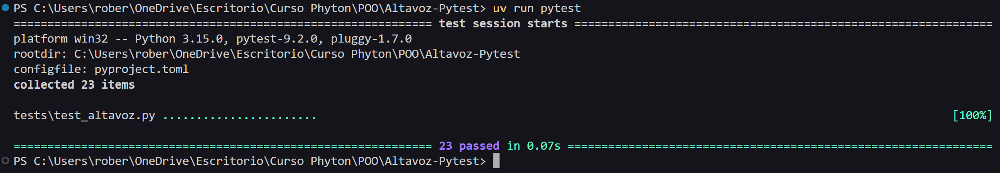
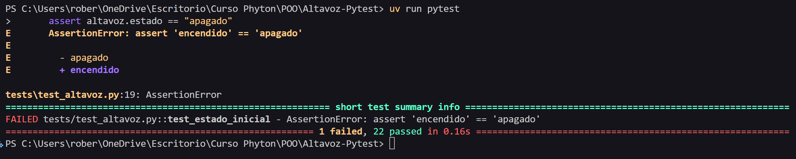

# Pruebas automatizadas de Altavoz

## 1. Objetivo

En esta segunda parte de la práctica he utilizado `pytest` para comprobar que la clase `Altavoz` sigue funcionando como esperamos. La ventaja es que puedo ejecutar todas las pruebas de una vez cuando cambie el código y ver que todo sigue igual.

## 2. Requisitos comprobados

| Requisito | Qué compruebo |
| --- | --- |
| Creación del altavoz | Guarda el nombre y el volumen y empieza apagado. |
| Nombre | Se puede consultar y modificar, elimina los espacios al principio y al final y rechaza valores no válidos. |
| Volumen | Se puede consultar y modificar, admite valores entre 0 y 100 y rechaza los valores incorrectos. |
| Estado | Se puede consultar, pero no se puede asignar directamente. |
| Métodos | `encender()` y `apagar()` cambian el estado como deseamos. |

## 3. Casos de prueba

He creado cuatro grupos de pruebas, clasificados de la siguiente manera:

- **Creación:** compruebo el nombre, el volumen y el estado inicial.
- **Propiedades:** pruebo cambios de nombre y volumen, los espacios en el nombre y los valores del volumen.
- **Comportamiento:** compruebo que el altavoz se enciende, se apaga y se puede apagar después de encenderlo.
- **Datos incorrectos:** compruebo que se genera `ValueError` al usar nombres o volúmenes no válidos. Para intentar cambiar directamente `estado`, compruebo que se genera `AttributeError`.

He usado `assert` para comparar resultados y `pytest.raises()` para las excepciones.

## 4. Ejecución de las pruebas

Para instalar pytest y ejecutar las pruebas en mi proyecto se utilizan estos comandos:

```bash
uv add --dev pytest
uv run pytest
```

Al comprobar el archivo de pruebas con la clase original, el resultado obtenido fue:





## 5. Prueba de robustez

Para comprobar que las pruebas detectan errores, hice un cambio, sustituí temporalmente:

self._encendido = False

por:

self._encendido = True


Con este cambio, un altavoz nuevo comienza encendido cuando debería comenzar apagado. Al ejecutar las pruebas sobre esa copia, el resultado fue:



La prueba que falló comparaba el estado inicial con `"apagado"`, pero obtuvo `"encendido"`. Esto demuestra que la batería de pruebas puede detectar ese cambio incorrecto. Además, al deshacer este cambio, todas las pruebas volvieron a pasarse correctamente.

## 6. Revisión con IA

Pedí a una IA que revisara qué situaciones estaba comprobando. Estas fueron las sugerencias que valoré:

| Sugerencia | Decisión | Motivo |
|---|---|---|
| Comprobar qué ocurre si encendemos dos veces seguidas el altavoz. | La incorporé. | Me pareció útil comprobar que, si el altavoz ya está encendido y volvemos a llamar a `encender()`, sigue encendido y no se produce ningún error. |
| Añadir más pruebas con valores intermedios del volumen. | La descarté. | Ya tengo pruebas con los valores mínimo y máximo (0 y 100), además de otros valores intermedios como 30. Considero que añadir más pruebas similares no aportaría mucho. |

La IA me ayudó a identificar otros posibles casos de prueba. Añadí la prueba `test_encender_dos_veces()` y comprobé su resultado ejecutando Pytest. No incorporé todas las sugerencias porque algunas situaciones ya estaban suficientemente comprobadas.

La IA sirvió para pensar en más casos, pero las pruebas se comprobaron ejecutando el programa.

## 7. Reflexión final

Me parece útil utilizar `pytest` porque puedo detectar más rápido si un cambio estropea algo que antes funcionaba. También es más cómodo que hacer las comprobaciones una por una.

Que todas las pruebas pasen no significa que el programa sea perfecto, pero sí que funciona correctamente en los casos que he probado.
